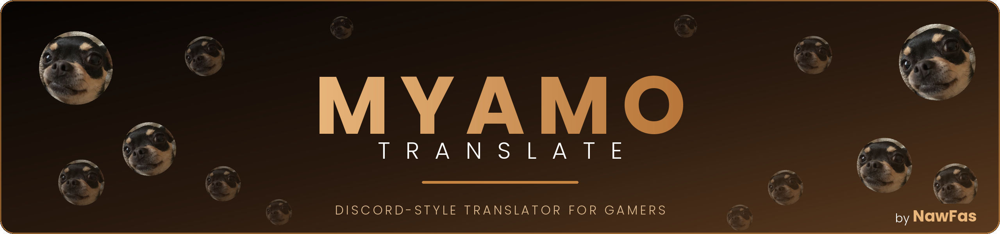

<div align="center">



<br>


**Translate like you actually talk on Discord.**
Short, slangy, no textbook English.


[Download](../../releases/latest) &nbsp;|&nbsp; [Setup](#setup) &nbsp;|&nbsp; [Build from source](#build-from-source)

</div>

---

## What it does

Paste a message, pick a mode, get three ready-to-send variants.

| Mode | Input | Output |
|------|-------|--------|
| **FR → EN** | French | Discord-style English: casual, ultra short, full gamer |
| **FR → RU** | French | Russian slang as used on Discord and Telegram |
| **Auto → FR** | English or Russian | Natural French, with the slang explained |

Example: *"je sais pas, on verra plus tard"* becomes *"idk, we'll see later"* or just *"idk nvm"*.

## Features

- Slang-first translations, never stiff or schoolbook
- Always-on-top toggle, so it can sit next to your game or chat
- Glass-style HUD with a black and caramel theme and an animated starfield
- Lightweight: one window, one shortcut, nothing running in the background
- Your API key stays on your machine

## Install

1. Grab `MYAMO-Translate-Setup.exe` from the [latest release](../../releases/latest).
2. Run it. It installs per user and adds a desktop shortcut.

> Windows SmartScreen may warn about an unsigned app. Click **More info**, then **Run anyway**.

## Setup

MYAMO uses the Gemini API, which has a free tier.

1. Create a key at [Google AI Studio](https://aistudio.google.com/apikey). It starts with `AIza`.
2. Open the app, click the gear icon, paste the key and save.

The key is stored in `%APPDATA%\MYAMO Translate\config.json` and only ever sent to Google.

## Build from source

```bash
git clone https://github.com/54cm/MYAMO_Translate.git
cd MYAMO_Translate
pip install pywebview requests
python app.py
```

To produce the `.exe` and the installer, run `build.bat`. The installer step needs [NSIS](https://nsis.sourceforge.io).

```
dist/
  MYAMO Translate.exe
  MYAMO-Translate-Setup.exe
```

## Stack

Python, [pywebview](https://pywebview.flowrl.com), HTML/CSS/JS, Gemini API, PyInstaller, NSIS.

## License

MIT. Do what you want, just keep the notice.

---

<div align="right">

</div>
